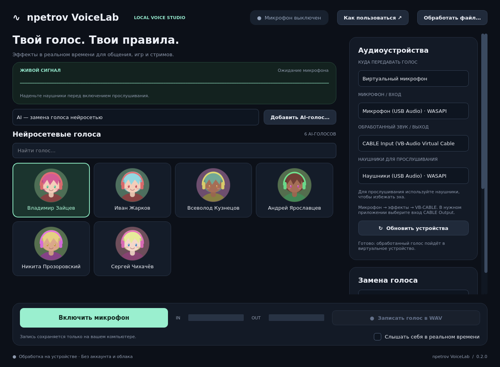

# VoiceLab для Windows

Локальное приложение для изменения голоса в Discord, играх и голосовом чате. Русский интерфейс, **48 голосовых пресетов**, карточки с оригинальными аватарами, поиск и категории. Работает без аккаунта, платного API, видеокарты и скачивания голосовых моделей.

Это DSP-обработка: высота, эквализация тембра, кольцевая модуляция, хорус, перегруз, эхо и реверберация. Пресеты «Аниме», «Женские» и другие — звуковые образы; они не воспроизводят точный голос актёра или персонажа. Результат зависит от исходного голоса и микрофона.



## Запуск на Windows 10/11 x64

1. Скачайте **`VoiceLab-Setup.exe`** из [Releases](https://github.com/steamnpetrov95-ux/voice_ai/releases). Это один установщик; Python, исходники и команды не нужны. Релиз появляется после успешной сборки и проверки на Windows.
2. Запустите установщик. Оставьте включённой опцию **«Установить виртуальный микрофон VB-CABLE»**. Он сам скачает официальный драйвер, проверит подпись издателя и запустит оригинальную программу установки VB-CABLE. Для этого шага нужны интернет и разрешение Windows на установку драйвера. Если драйвер уже установлен, этот шаг пропускается.
3. В окне VB-CABLE нажмите **Install Driver**. Если установщик запросит перезагрузку, перезагрузите Windows. Голосовой драйвер скачивается с сайта производителя, а не распространяется копией внутри VoiceLab.
4. Откройте VoiceLab с ярлыка на рабочем столе или из меню «Пуск». Выберите физический микрофон и нажмите «Включить микрофон». В Discord/игре выберите вход **CABLE Output**.
5. Для проверки без виртуального драйвера переключите режим на «Прослушивание в наушниках» и выберите наушники. Не используйте колонки: это может вызвать обратную связь.

Приложение устанавливается для текущего пользователя; права администратора запрашиваются только для установки драйвера. Настройки хранятся в `%APPDATA%\VoiceLab\settings.json`; записи сохраняются в выбранное вами место. Приложение не отправляет аудио в сеть. Индикатор «Живой сигнал» показывает обработанный звук.

Если установка драйвера не завершилась, нажмите **«Установить виртуальный микрофон»** в VoiceLab: скачивание и установка запускаются повторно. Ошибка сети, отмена запроса администратора или неподтверждённая подпись не удаляют уже установленное приложение. Существующие записи и настройки при удалении приложения сохраняются.

## Запуск исходников для разработчика

Установите [Python 3.12 x64](https://www.python.org/downloads/windows/) с Python Launcher (`py`), скачайте и распакуйте проект, затем откройте `Start-VoiceLab.bat`. При первом запуске зависимости устанавливаются автоматически. Для восстановления зависимостей выполните в папке проекта:

```powershell
powershell -NoProfile -ExecutionPolicy Bypass -File scripts\setup-windows.ps1
```

Если установлен `py`, скрипт использует Python 3.12. Без `py` поддерживается команда `python` версии 3.11–3.13, x64. Рекомендуемый и целевой вариант сборки — Python 3.12 x64.

## Подключение к Discord и играм

Виртуальный аудиокабель устанавливается из мастера VoiceLab либо кнопкой в приложении. Это официальный драйвер VB-CABLE; само приложение не заменяет системный аудиодрайвер.

1. Если VB-CABLE ещё не установлен, используйте кнопку установки в VoiceLab. Альтернативный ручной вариант — [официальный сайт](https://vb-audio.com/Cable/). После установки перезагрузите Windows, если этого потребует драйвер.
2. В VoiceLab оставьте режим **«Виртуальный микрофон»** и выберите ваш физический микрофон. Приложение автоматически найдёт **CABLE Input (VB-Audio Virtual Cable)**. В этом режиме обычные колонки/наушники не используются как выход. Если кабель не обнаружен, запуск блокируется и показывается кнопка установки.
3. В Discord → Настройки → Голос и видео → Устройство ввода выберите **CABLE Output (VB-Audio Virtual Cable)**. В игре выберите такое же устройство ввода.
4. Устройство **вывода** Discord оставьте на наушниках. Нажмите «Включить микрофон» в VoiceLab.
5. Если Discord срезает эффекты, попробуйте отключить Krisp/шумоподавление, эхоподавление и автоматическое усиление. Входную чувствительность настройте вручную.

Маршрут: **микрофон → VoiceLab → CABLE Input → CABLE Output → Discord/игра**.

Виртуальный CABLE Output скрыт из списка микрофонов VoiceLab, чтобы не создавать звуковую петлю. Изменить устройства и режим можно после остановки микрофона. Обновите список после подключения нового устройства. Устройства должны поддерживать общую частоту 48 кГц либо 44,1 кГц; движок проверяет оба варианта.

## Русская речь и настройка голосов

Обработка работает со звучащей речью на любом языке и не переводит текст. Профиль **«Русская речь»** добавляет фильтрацию низкочастотного шума, мягкую компрессию и регулируемое выделение диапазона согласных около 2,6 кГц. Это помогает разборчивости, но не является языковой моделью или коррекцией акцента.

- **Высота голоса:** от −12 до +12 полутонов без изменения темпа. Экстремальные настройки дают более искусственный звук.
- **Тембр:** эквализация от яркого к тёплому. Это не независимое нейросетевое преобразование формант.
- **Разборчивость речи:** 0–6 дБ усиления присутствия, когда включён речевой профиль. Если шипящие резкие, уменьшите значение.
- **Пространство:** реверберация. Для разговоров начните с 0–15%.
- **Усиление:** настройте так, чтобы выходной индикатор редко достигал максимума. Выход ограничен диапазоном −1…1.
- **Отключить эффекты:** передача исходного голоса по тому же маршруту.

Сохраняются выбранный пресет, устройства и ручные настройки. При выборе нового пресета ручные настройки заменяются его параметрами. Переключение высоты/пресета заново запускает буфер эффекта и может дать короткую паузу. Обработка не имеет нулевой задержки: изменение высоты добавляет примерно 60–100 мс при 48 кГц, кроме буферов устройств и виртуального кабеля. Фактическая задержка зависит от Windows и аудиодрайвера.

## Запись и обработка файлов

«Записать голос в WAV» сохраняет обработанный сигнал, пока включён микрофон. После остановки записи или микрофона WAV-файл закрывается. Сохраняйте запись под новым именем: приложение не перезаписывает существующие файлы.

«Обработать файл» применяет текущие настройки к записи без микрофона. Выход — моно WAV PCM16 с исходной частотой; при активной обработке добавляется секунда для буфера эффекта и хвоста реверберации. Поддержка входных форматов зависит от libsndfile; WAV/FLAC подходят для проверки.

То же из командной строки:

```powershell
.venv\Scripts\python.exe -m voicelab --list-devices
.venv\Scripts\python.exe -m voicelab --render input.wav output.wav --preset sakura
```

## Сборка приложения без Python на целевом компьютере

Разработчику нужны Python 3.12 x64 и [Inno Setup 6 или 7](https://jrsoftware.org/isdl.php). На Windows дважды нажмите **`Build-Windows.bat`**. Скрипт устанавливает зафиксированные зависимости, запускает тесты, собирает приложение через PyInstaller и создаёт **один файл `dist\installer\VoiceLab-Setup.exe`**. Только этот EXE передаётся пользователю. Он включает Python, Qt, обработчик звука и мастер скачивания/установки виртуального микрофона. Рядом создаётся SHA256-файл для проверки загрузки.

В `.github/workflows/windows.yml` есть Windows CI: тесты, проверка загрузки и подписи VB-CABLE без установки драйвера на runner, сборка установщика, установка в тестовую папку, обработка WAV установленным EXE и удаление. Артефакт — `VoiceLab-Setup-Windows-x64`. Push тега `v*` создаёт GitHub Release с установщиком и SHA256 **только после прохождения всех этих проверок**. Прямой тест драйвера: `powershell -NoProfile -ExecutionPolicy Bypass -File installer\Install-VirtualMicrophone.ps1 -VerifyOnly`.

## Разработка и проверка

```powershell
powershell -NoProfile -ExecutionPolicy Bypass -File scripts\setup-windows.ps1
.venv\Scripts\python.exe -m pytest -q
.venv\Scripts\python.exe -m voicelab
```

Если используется `uv`: `uv sync --frozen --extra dev`, затем `uv run --frozen --extra dev python -m pytest -q`. На Linux дополнительно нужна системная библиотека PortAudio (`libportaudio2`); для проверки интерфейса без дисплея задайте `QT_QPA_PLATFORM=offscreen`. Инструкция для этой облачной среды находится в [docs/VALIDATION.md](docs/VALIDATION.md).

Тесты проверяют каждый из 48 пресетов на потоке блоков, реальное изменение частоты, модуляцию, речевую эквализацию, WAV, защиту от перезаписи, передачу обработанного сигнала между аудиоколбэками с имитацией устройств, освобождение ресурсов при ошибке, поиск и настройки интерфейса.

Отсутствие звука: проверьте разрешение доступа к микрофону для классических приложений Windows, выбранный вход/выход, уровень записи и отсутствие эксклюзивного захвата другим приложением. Если счётчик потерь буфера постоянно растёт, закройте тяжёлые программы или выберите другой вариант того же устройства с другим API. WASAPI обычно предпочтительнее MME, но совместимость зависит от драйвера.

Зависимости: PySide6 Essentials (Qt), NumPy, Pedalboard, sounddevice/PortAudio, SoundFile/libsndfile. Их лицензии и уведомления следует сохранять при распространении собранного приложения.
